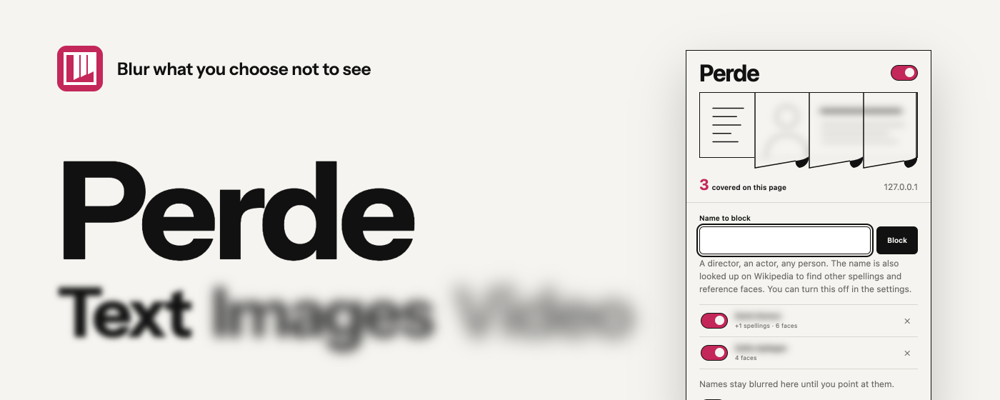
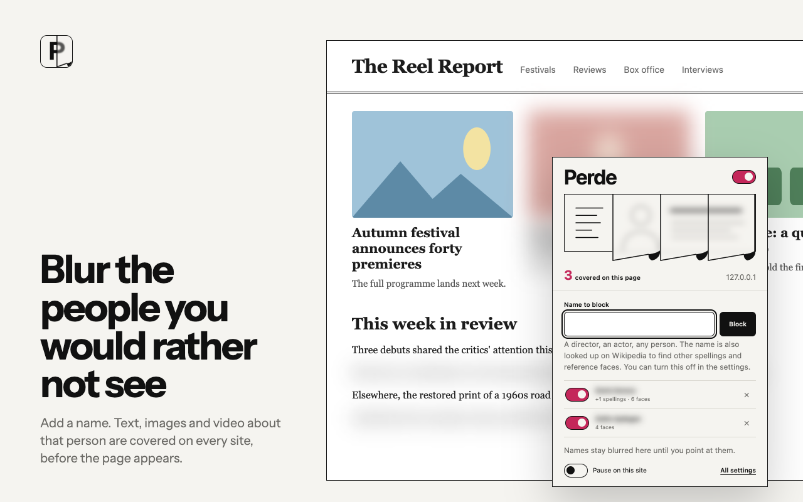
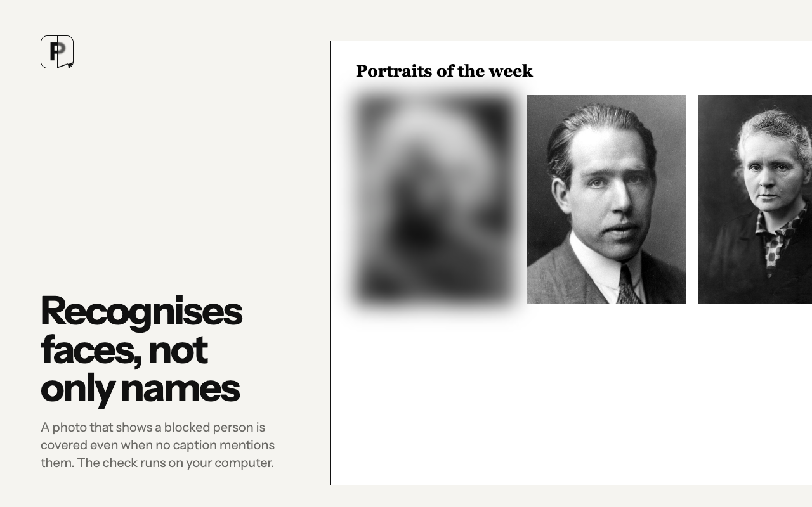
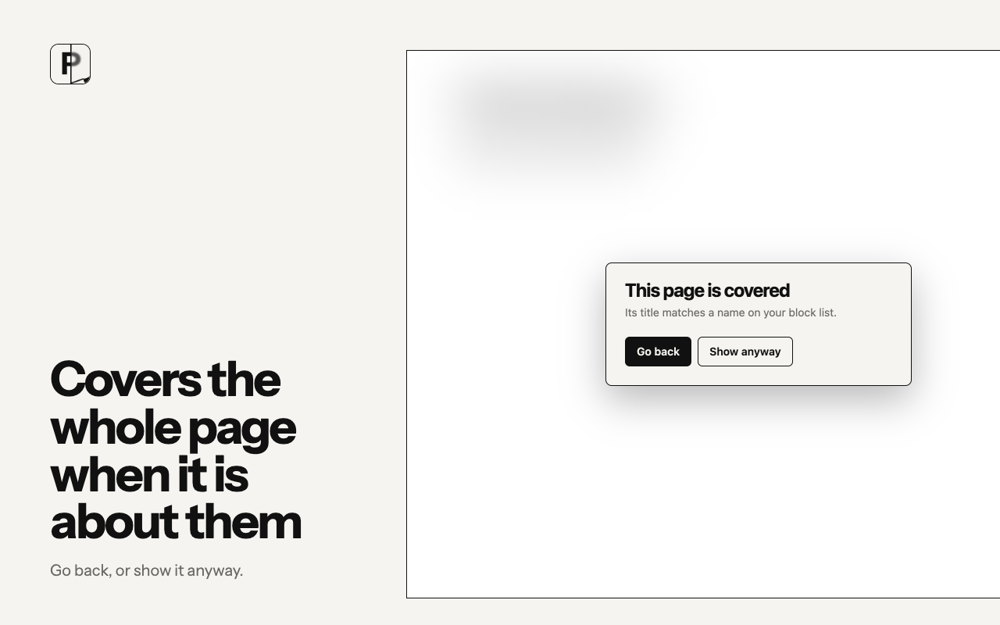
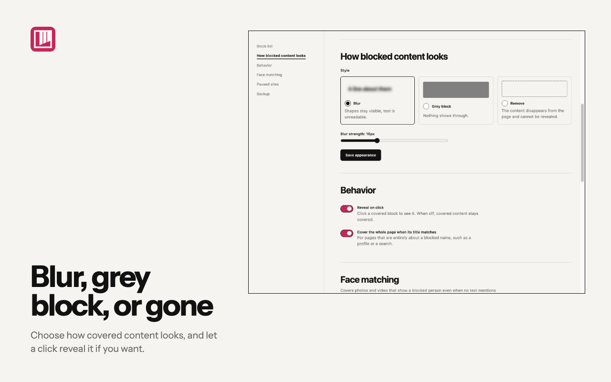
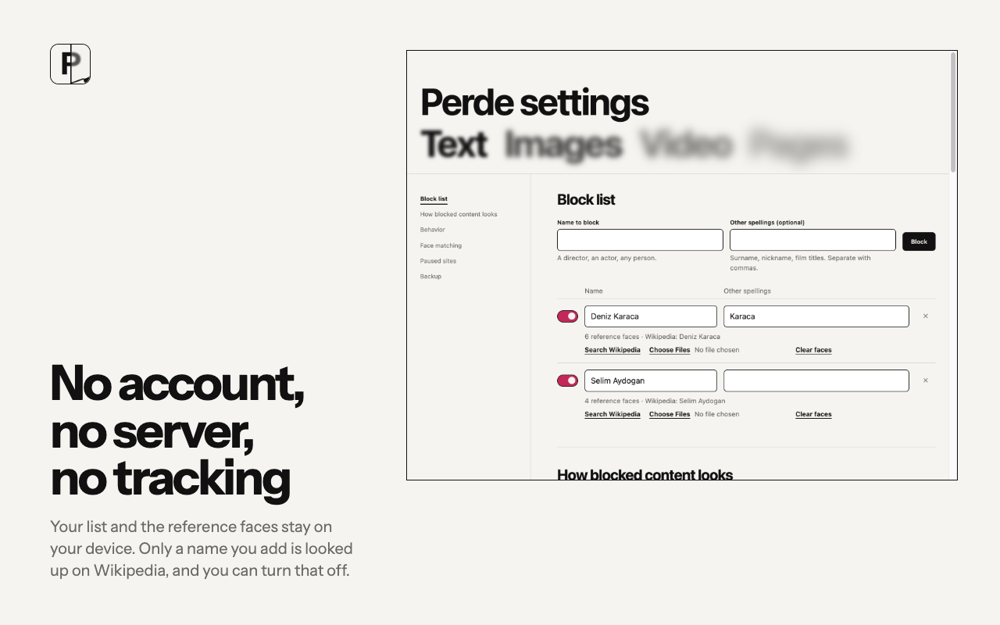

<p align="center">
  
</p>

# Perde

[](https://github.com/onatakduman/perde/actions/workflows/ci.yml)
[](https://github.com/onatakduman/perde/releases/latest)
[](LICENSE)

*Türkçe: [README.tr.md](README.tr.md)*

Perde ("curtain" in Turkish) is a Chrome extension that covers content about people you would rather not see. You give it names; it blurs the text, images and video that mention or show them, on every site, before the page is painted.

Everything is decided on your computer. There is no account, no server and no analytics.

## Features

- **Names in text, on every site.** Add a name once and it is covered wherever it appears, before the page is painted. Case and accents are ignored, and you can list other spellings such as a surname or a nickname.
- **As much or as little as you want.** Cover only the name (the default), its line or paragraph, or the whole card around it, thumbnail included.
- **Images, with or without a caption.** An image is covered when its alt text, file name, link or caption mentions the name. With reference faces, a photo that only shows the person is covered too.
- **Video.** A playing video is checked about twice a second and covered while the face is on screen.
- **Whole pages.** A page whose title matches is covered completely, with "Go back" and "Show anyway".
- **Reference faces without looking at the person.** Perde reads them from Wikipedia and Wikimedia Commons for you. No photo is shown to you or stored.
- **Three looks.** Blur with adjustable strength, a grey block, or removal from the page. A click reveals a blurred block unless you turn that off.
- **Quick to add, easy to pause.** Type a name in the popup, or select one on a page and right-click. Pause Perde on a single site or switch it off entirely. The toolbar badge counts what is covered on the page.
- **Private.** The block list and the face references stay in the browser, and images are compared on your device.
- **Backup.** Export the list to a file and import it in another browser. The [macOS companion](#macos-companion) reads the same file.
- **English and Turkish.** The interface follows the browser's language.

## Screenshots

| | |
|---|---|
|  |  |
|  |  |



## How content is recognised

| Content | How it is recognised | When it is covered |
|---|---|---|
| Text | The name or one of its other spellings, ignoring case and accents (`DENİZ KARACA'nın` matches `Deniz Karaca`; `Karacaoğlan` does not match `Karaca`) | Before the first paint |
| More than the name, if you want | A setting: only the name (the default), its line or paragraph, or the whole card around it (a search result, a tweet, a video tile with its thumbnail) | Before the first paint |
| Images described in text | Alt text, file name, the link around the image, the caption | Before the first paint |
| Images that only show the person | An on-device face model compares faces with reference faces for that name | The image stays blurred until the check is done, then opens or stays covered |
| Playing video | A frame is checked about twice a second | While the face is on screen; the first moment of a scene can be visible |
| Whole pages | The page title matches | Before the first paint, with "Go back" and "Show anyway" |

Covered content can be blurred, replaced by a grey block, or removed from the page. A click reveals a blurred block unless you turn that off.

## Reference faces without looking at the person

Collecting photos of someone you do not want to see defeats the purpose, so Perde does it for you. When you add a name it looks the person up on Wikipedia, checks on Wikidata that the article is about a human, and reads reference faces from the article's lead photo and from Wikimedia Commons. Photos are only accepted when the face in them clearly matches the lead photo. No photo is shown to you or kept: only 128 numbers per face are stored.

You can turn the lookup off, add your own photos instead, or clear the faces of any name in the settings.

## Install

**From source**

1. Clone this repository: `git clone https://github.com/onatakduman/perde.git`
2. Open `chrome://extensions`, turn on **Developer mode**, choose **Load unpacked** and select the `perde` folder.

Requires Chrome 123 or later.

## Use

- Click the toolbar icon and type a name, or select a name on any page, right-click and choose **Perde: block**.
- Open **All settings** for other spellings, reference faces, the look of covered content, face sensitivity, paused sites and backup.
- The toolbar badge shows how many blocks are covered on the current page.

## Limits

- An image with no describing text is only caught when the name has reference faces and the face is large and clear enough. Faces smaller than roughly 40 pixels, heavy profile views and masks are often missed.
- Face matching makes mistakes in both directions: look-alikes can be covered and unusual photos can be missed. The sensitivity setting trades one for the other.
- Video is sampled, not analysed frame by frame. Protected (DRM) video and cross-origin video without CORS cannot be read by any extension.
- CSS background images are not checked.
- A name split across elements (`Deniz <b>Karaca</b>`) only matches if the part on its own is listed as another spelling.
- The text in the tab strip cannot be covered.

## Privacy

See [PRIVACY.md](PRIVACY.md). In short: the block list and the face references stay in the browser's local extension storage. The only thing sent anywhere is the name you add, to Wikipedia, Wikidata and Wikimedia Commons, and only while the lookup setting is on. Images are compared on your device.

## macOS companion

[`mac/`](mac/) holds a small menu-bar app that applies the same block list to the whole screen (any app, not just the browser) by reading the screen with ScreenCaptureKit and Vision. Export your list from the extension's settings and the app reads the same file. See [mac/README.md](mac/README.md) for what it can and cannot do.

## Project layout

```
perde/                 the extension (load this folder unpacked)
  manifest.json
  shared/common.js     settings, name matching, backup format
  content/             finds and covers content in pages
  background/          context menu, badge, face references, Wikipedia lookup
  offscreen/           hidden page that runs the face model
  popup/  options/     the two pieces of UI
  vendor/face-api/     third-party face model (see THIRD_PARTY_NOTICES.md)
  vendor/fonts/        Instrument Sans, the interface typeface
  _locales/            English and Turkish
mac/                   macOS menu-bar app
tests/                 end-to-end tests
scripts/               packaging and vendoring
```

## Development

```bash
npm install
npx playwright install chromium
npm test            # text, cards, images by context, settings, popup (offline)
npm run test:faces  # face matching and the Wikipedia lookup (needs the network)
npm run package     # dist/perde-v<version>.zip for the Chrome Web Store
npm run vendor      # re-create perde/vendor (face model and fonts) from the npm packages
```

The tests load the unpacked extension into Chromium. Branded Google Chrome no longer accepts `--load-extension`, so they need Chromium or Chrome for Testing; point `CHROMIUM` at a binary to use a specific one.

## Continuous integration and releases

- **CI** (`.github/workflows/ci.yml`) runs on every push to `main` and on pull requests: `npm run check`, the end-to-end tests in Chromium, the store package as a build artifact, and `swift build` plus `swift test` for the macOS app.
- **Release** (`.github/workflows/release.yml`) runs when a tag is pushed. Bump `version` in `perde/manifest.json` and `package.json`, commit, then:

  ```bash
  git tag v0.2.2 && git push origin v0.2.2
  ```

  The tag has to match the manifest version. The workflow tests, packages, and creates a GitHub release with `perde-v<version>.zip` attached.
- **Chrome Web Store upload** is the third job of the release workflow: the same tag also sends the package to the store. The store listing itself (texts, screenshots, privacy answers) cannot be set through the API and stays in the dashboard.

### Chrome Web Store upload

The job signs in as a Google Cloud service account through workload identity federation, so the repository stores no key, password or token. It stays off until four repository variables exist. One-time setup:

1. Run the setup script where `gcloud` is signed in; [Cloud Shell](https://shell.cloud.google.com) is the quickest place. Pick any unused project id.

   ```bash
   curl -fsSL https://raw.githubusercontent.com/onatakduman/perde/main/scripts/setup-store-upload.sh | bash -s -- my-store-upload-project owner/repository
   ```

   It creates the project, enables the Chrome Web Store API, creates the service account, and allows only the given repository to act as it. It ends by printing the service account address and two `gh variable set` commands.
2. In the Chrome Web Store Developer Dashboard, open **Account** and add the printed address as the service account.
3. Set the repository variables (Settings > Secrets and variables > Actions > Variables):
   - `CWS_SERVICE_ACCOUNT` and `CWS_WORKLOAD_IDENTITY_PROVIDER`, as printed by the script;
   - `CWS_PUBLISHER_ID` and `CWS_EXTENSION_ID`, both visible in the address of the item's page in the dashboard: `.../u/0/developer/dashboard/<publisher id>/<extension id>/edit`.

From then on every release tag uploads the package as a new draft, and you submit it for review in the dashboard. Set the variable `CWS_AUTO_PUBLISH` to `true` to have the workflow submit it for review as well. To upload without a new tag, start the Release workflow by hand with **store_upload** ticked (Actions > Release > Run workflow).

The store refuses a new package while the item is in review ("You may not edit or publish an item that is in review"), and the job fails with that message. Run the workflow again by hand once the review is over, or cancel the submission in the dashboard first.

## License

[MIT](LICENSE). Third-party components are listed in [THIRD_PARTY_NOTICES.md](THIRD_PARTY_NOTICES.md).
