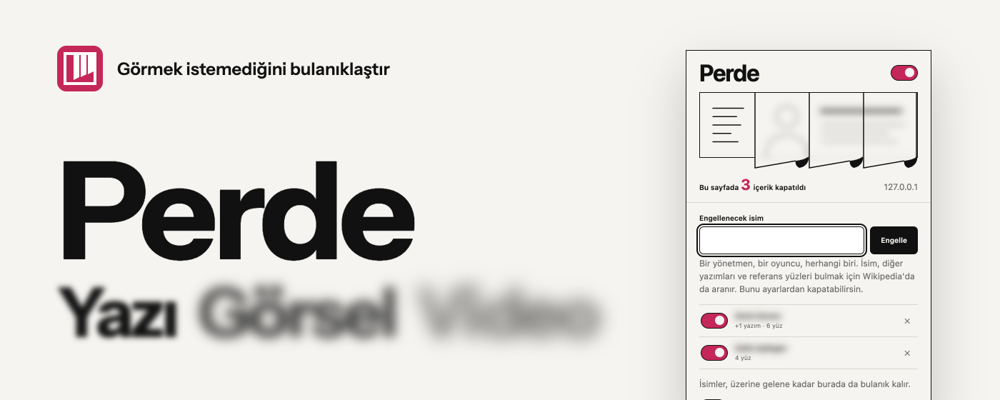
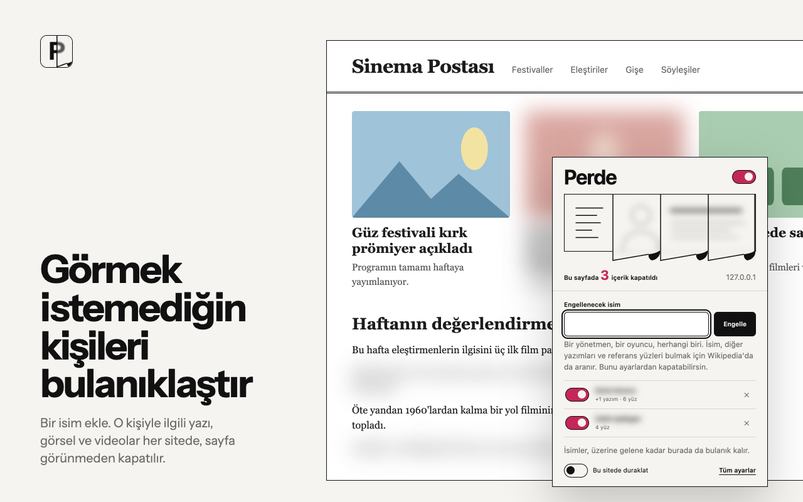
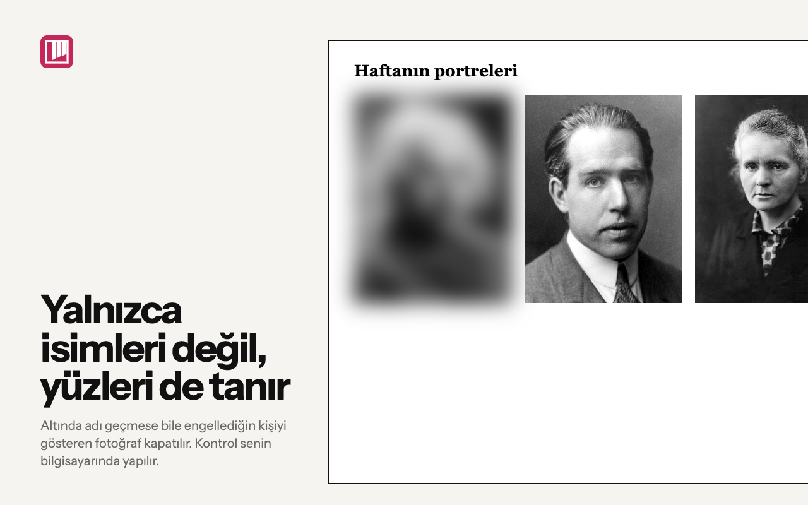
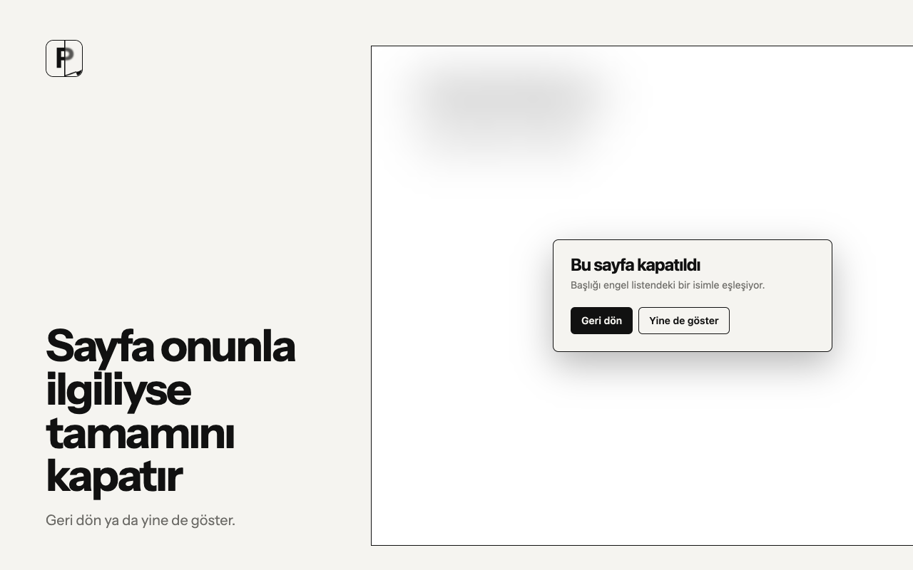
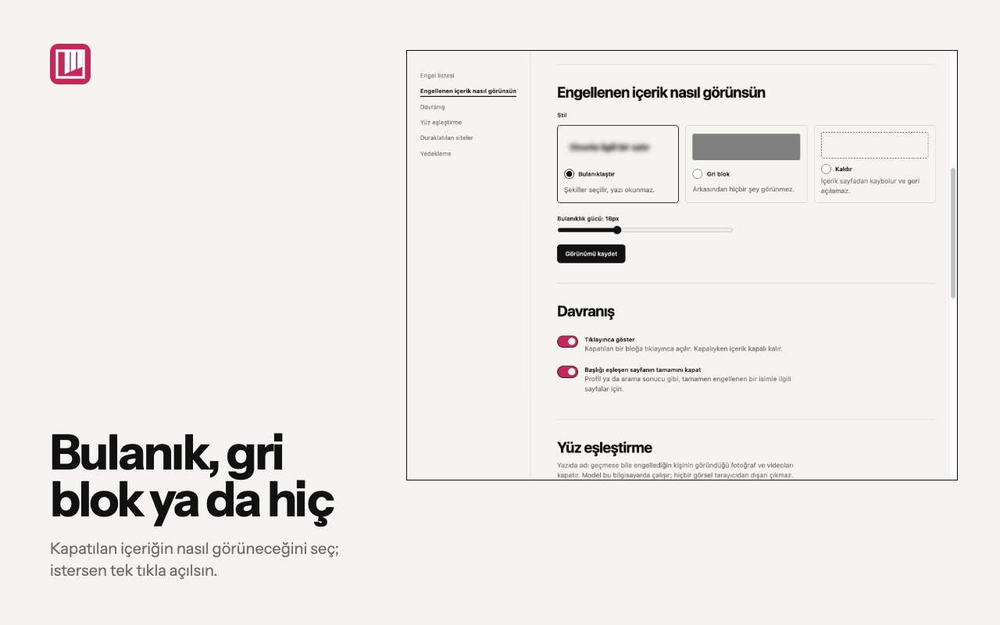
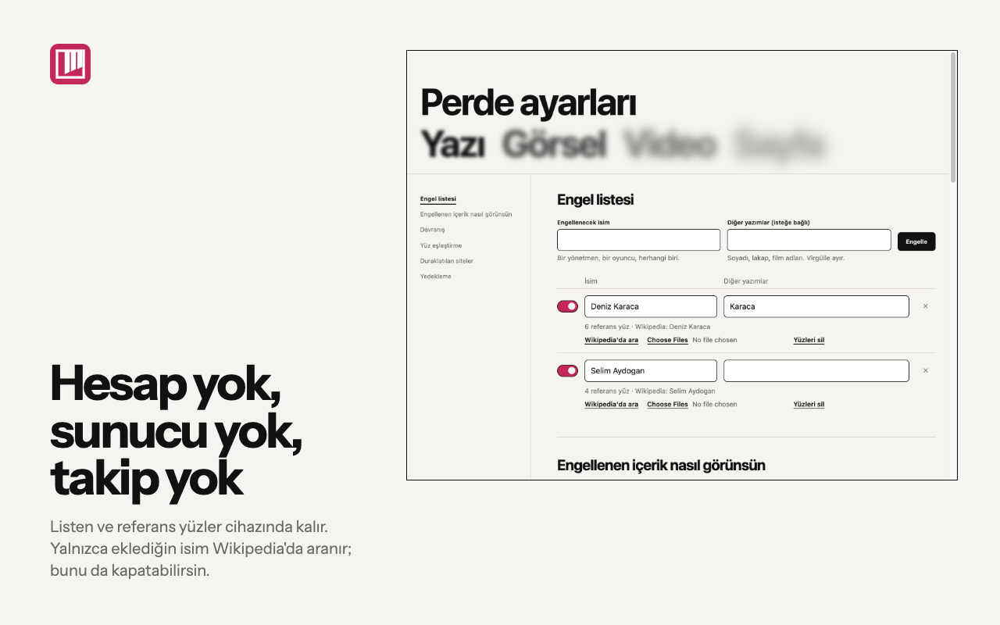

<p align="center">
  
</p>

# Perde

[](https://github.com/onatakduman/perde/actions/workflows/ci.yml)
[](https://github.com/onatakduman/perde/releases/latest)
[](LICENSE)

*English: [README.md](README.md)*

Perde, görmek istemediğin kişilerle ilgili içeriği kapatan bir Chrome eklentisidir. Sen isimleri verirsin; Perde bu kişilerden bahseden ya da onları gösteren yazıları, görselleri ve videoları, her sitede, sayfa ekrana çizilmeden bulanıklaştırır.

Her karar senin bilgisayarında verilir. Hesap, sunucu ya da analitik yoktur.

## Özellikler

- **Yazıdaki isimler, her sitede.** Bir ismi bir kez eklersin; geçtiği her yerde, sayfa ekrana çizilmeden kapanır. Büyük/küçük harf ve aksan farkı gözetilmez; soyadı ya da lakap gibi diğer yazımları da ekleyebilirsin.
- **İstediğin kadarı.** Yalnızca isim (varsayılan), satırı ya da paragrafı, ya da küçük resmiyle birlikte içinde olduğu kartın tamamı kapanır.
- **Altında yazı olsun olmasın, görseller.** Alt metni, dosya adı, bağlantısı ya da resim altı yazısı ismi içeren görsel kapanır. Referans yüz varsa, yalnızca kişiyi gösteren fotoğraf da kapanır.
- **Video.** Oynayan video saniyede yaklaşık iki kez kontrol edilir ve yüz ekrandayken kapanır.
- **Tüm sayfa.** Başlığı eşleşen sayfa, "Geri dön" ve "Yine de göster" seçenekleriyle tamamen kapanır.
- **Kişiye bakmadan referans yüz.** Perde yüzleri senin yerine Wikipedia ve Wikimedia Commons'tan okur. Sana hiçbir fotoğraf gösterilmez, hiçbiri saklanmaz.
- **Üç görünüm.** Gücü ayarlanabilen bulanıklık, gri blok ya da sayfadan kaldırma. Kapatmadığın sürece, bulanık bir bloğa tıklamak onu açar.
- **Eklemesi hızlı, duraklatması kolay.** İsmi açılır pencereye yaz ya da sayfada seçip sağ tıkla. Perde'yi tek bir sitede duraklatabilir ya da tamamen kapatabilirsin. Araç çubuğundaki rozet, sayfada kaç şeyin kapatıldığını gösterir.
- **Gizli.** Engel listesi ve yüz referansları tarayıcıda kalır; görseller cihazında karşılaştırılır.
- **Yedekleme.** Listeyi bir dosyaya aktarıp başka bir tarayıcıda içe aktarabilirsin. [macOS uygulaması](#macos-uygulaması) aynı dosyayı okur.
- **Türkçe ve İngilizce.** Arayüz, tarayıcının dilini izler.

## Ekran görüntüleri

| | |
|---|---|
|  |  |
|  |  |



## İçerik nasıl tanınır

| İçerik | Nasıl tanınır | Ne zaman kapanır |
|---|---|---|
| Yazı | İsim ya da diğer yazımlarından biri; büyük/küçük harf ve aksan farkı gözetilmez (`DENİZ KARACA'nın`, `Deniz Karaca` ile eşleşir; `Karacaoğlan`, `Karaca` ile eşleşmez) | İlk çizimden önce |
| İstersen isimden fazlası | Bir ayar: yalnızca isim (varsayılan), satırı ya da paragrafı, ya da içinde olduğu kartın tamamı (arama sonucu, tweet, küçük resmiyle video kutusu) | İlk çizimden önce |
| Yazıyla tarif edilen görseller | Alt metni, dosya adı, görseli saran bağlantı, resim altı yazısı | İlk çizimden önce |
| Yalnızca kişiyi gösteren görseller | Cihazda çalışan bir yüz modeli, yüzleri o isme ait referans yüzlerle karşılaştırır | Görsel, kontrol bitene kadar bulanık kalır; sonra açılır ya da kapalı kalır |
| Oynayan video | Saniyede yaklaşık iki kare kontrol edilir | Yüz ekrandayken; sahnenin ilk anı görünebilir |
| Tüm sayfa | Sayfa başlığı eşleşir | İlk çizimden önce, "Geri dön" ve "Yine de göster" seçenekleriyle |

Kapatılan içerik bulanıklaştırılabilir, gri bir blokla değiştirilebilir ya da sayfadan kaldırılabilir. Kapatmadığın sürece, bulanık bir bloğa tıklamak onu açar.

## Kişiye bakmadan referans yüz

Görmek istemediğin birinin fotoğraflarını toplamak amaca ters düşer; bu yüzden Perde bunu senin yerine yapar. Bir isim eklediğinde kişiyi Wikipedia'da arar, maddenin bir insan hakkında olduğunu Wikidata'dan doğrular, referans yüzleri maddenin ana fotoğrafından ve Wikimedia Commons'tan okur. Bir fotoğraf ancak içindeki yüz ana fotoğrafla açıkça eşleşiyorsa kabul edilir. Sana hiçbir fotoğraf gösterilmez, hiçbiri saklanmaz: her yüz için yalnızca 128 sayı tutulur.

Ayarlardan aramayı kapatabilir, kendi fotoğraflarını ekleyebilir ya da bir ismin yüzlerini silebilirsin.

## Kurulum

**Kaynaktan**

1. Bu depoyu klonla: `git clone https://github.com/onatakduman/perde.git`
2. `chrome://extensions` sayfasını aç, **Geliştirici modu**nu aç, **Paketlenmemiş öğe yükle**'ye tıkla ve `perde` klasörünü seç.

Chrome 123 ya da üzeri gerekir.

## Kullanım

- Araç çubuğundaki simgeye tıkla ve bir isim yaz; ya da herhangi bir sayfada bir ismi seç, sağ tıkla ve **Perde: engelle**'yi seç.
- Diğer yazımlar, referans yüzler, kapatılan içeriğin görünümü, yüz hassasiyeti, duraklatılan siteler ve yedekleme için **Tüm ayarlar**'ı aç.
- Araç çubuğundaki rozet, o sayfada kaç bloğun kapatıldığını gösterir.

## Sınırlar

- Yanında tarif edici yazı olmayan bir görsel, ancak ismin referans yüzü varsa ve yüz yeterince büyük ve netse yakalanır. Yaklaşık 40 pikselden küçük yüzler, tam profil pozlar ve maskeli yüzler çoğu zaman kaçar.
- Yüz eşleştirme iki yönde de hata yapar: benzeyen kişiler kapanabilir, alışılmadık fotoğraflar kaçabilir. Hassasiyet ayarı birini diğeriyle takas eder.
- Video kare kare değil, örneklenerek kontrol edilir. Korumalı (DRM) videoları ve CORS izni olmayan farklı kaynaklı videoları hiçbir eklenti okuyamaz.
- CSS arka plan görselleri kontrol edilmez.
- Öğelere bölünmüş bir isim (`Deniz <b>Karaca</b>`), ancak parçası ayrıca diğer yazım olarak eklenmişse eşleşir.
- Sekme başlığındaki yazı kapatılamaz.

## Gizlilik

Ayrıntı için [PRIVACY.md](PRIVACY.md). Özetle: engel listesi ve yüz referansları tarayıcının yerel eklenti deposunda kalır. Dışarı giden tek şey eklediğin isimdir; Wikipedia, Wikidata ve Wikimedia Commons'a, yalnızca arama ayarı açıkken gönderilir. Görseller cihazında karşılaştırılır.

## macOS uygulaması

[`mac/`](mac/) klasöründe, aynı engel listesini tüm ekrana (yalnızca tarayıcıya değil, her uygulamaya) uygulayan küçük bir menü çubuğu uygulaması var. Ekranı ScreenCaptureKit ve Vision ile okur. Listeni eklentinin ayarlarından dışa aktar; uygulama aynı dosyayı okur. Neleri yapıp yapamadığı [mac/README.md](mac/README.md) dosyasında.

## Geliştirme

```bash
npm install
npx playwright install chromium
npm test            # yazı, kartlar, bağlamla görseller, ayarlar, popup (çevrimdışı)
npm run test:faces  # yüz eşleştirme ve Wikipedia araması (ağ gerekir)
npm run package     # Chrome Web Store için dist/perde-v<sürüm>.zip
npm run vendor      # perde/vendor klasörünü (yüz modeli ve yazı tipi) npm paketlerinden yeniden oluşturur
```

Testler, paketlenmemiş eklentiyi Chromium'a yükler. Markalı Google Chrome artık `--load-extension` kabul etmediği için Chromium ya da Chrome for Testing gerekir; belirli bir tarayıcı için `CHROMIUM` değişkenini onun dosyasına yönelt.

## Sürekli tümleştirme ve sürümler

- **CI** (`.github/workflows/ci.yml`) `main` dalına her gönderimde ve çekme isteklerinde çalışır: denetimler, Chromium'da uçtan uca testler, mağaza paketi ve macOS uygulamasının derlemesi ile testleri.
- **Release** (`.github/workflows/release.yml`) bir etiket gönderildiğinde çalışır. `perde/manifest.json` ve `package.json` içindeki sürümü artır, commit'le, sonra:

  ```bash
  git tag v0.2.2 && git push origin v0.2.2
  ```

  Etiket, manifest sürümüyle aynı olmalı. İş akışı testleri çalıştırır, paketi oluşturur, `perde-v<sürüm>.zip` ekli bir GitHub sürümü yayımlar ve paketi Chrome Web Store'a taslak olarak yükler.
- **Chrome Web Store yüklemesi** bir Google Cloud servis hesabıyla yapılır; depoda anahtar, parola ya da token tutulmaz. Tek seferlik kurulum [README.md](README.md#chrome-web-store-upload) dosyasında anlatılır. `CWS_AUTO_PUBLISH` değişkeni `true` olursa iş akışı paketi incelemeye de gönderir; olmazsa incelemeye göndermek geliştirici panelinde elle yapılır.

## Lisans

[MIT](LICENSE). Üçüncü taraf bileşenler [THIRD_PARTY_NOTICES.md](THIRD_PARTY_NOTICES.md) dosyasında listelenir.
